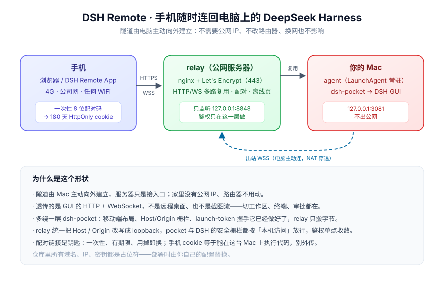

<div align="center">

# DSH Remote

**手机在任何网络下，连回电脑上的 [DeepSeek Harness](https://github.com/deepseek-ai) 完整 GUI**

不是远程桌面，也不是截图流——把 GUI 的 HTTP + WebSocket 原样透传过去。

`Node.js ≥ 20` · `Android 8+` · `MIT`

</div>



---

## 它解决什么

DeepSeek Harness 跑在电脑上，人却经常不在电脑前。DSH Remote 让你用手机浏览器或一个
五十来 KB 的安卓壳，在外面看到**同一个界面**：切工作区、聊天、看终端、审 diff、点审批。

关键在于隧道方向反过来了：

```
手机 ──HTTPS/WSS──►  公网 relay（nginx + TLS）
                          ▲
                          │ 出站 WSS，电脑主动连过去
                          │
                     agent（LaunchAgent 常驻）
                          │ 127.0.0.1
                          ▼
                     dsh-pocket → DSH GUI
```

- **电脑不需要公网 IP**，不动路由器，换 Wi-Fi / 断网重连都不影响。
- **服务器只负责接人**：鉴权、配对、多路复用；不解析、不缓存你的界面内容。
- **手机端零客户端**：浏览器直接能用；安卓壳只是补了「文件怎么交出去」这类手机才有的动作。

## 特性

| 能力 | 说明 |
| --- | --- |
| 完整 GUI | 工作区切换、会话、终端、diff、审批，和坐在电脑前一致 |
| 一次性配对 | 8 位配对码 → 180 天 HttpOnly cookie；配对码有期限、用掉即换 |
| 手机排版 | 注入 `polish.css` 收紧顶栏/留白/输入卡，不写死颜色，深色模式跟随页面 |
| 文件出手机 | 点文件卡 → 原生动作面板；长按 → 菜单里多一条「分享」 |
| APK 直装 | 手机上点 APK 直接交给系统安装器，不用去通知栏翻 |
| 发到微信 | `ACTION_SEND` + content URI，微信、QQ、钉钉都在分享面板里 |
| 断线可见 | 掉线显示橙色提示、恢复显示蓝色提示；原生错误页有「重试 / 重新配对」 |
| 任务提醒 | 跑完长任务弹 Toast；退到后台走系统通知 |
| 自愈 | DSH 重启后旧 `dsh-auth-*` cookie 会 401，agent 自己发现并重放一次 |

## 快速开始

本项目**只负责「从公网把手机接进来」**，它自己不含 DSH，也不含 dsh-pocket。零到能用是四步：
一台公网服务器 + 一台已经跑着 DSH 的 Mac。

### 0. 前置：Mac 上先有 DSH + dsh-pocket

| 需要 | 怎么装 | 验证 |
| --- | --- | --- |
| **DeepSeek Harness** | `npm install -g @deepseek-ai/dsh`（或直接装 DSH 桌面版） | `dsh --version` |
| **dsh-pocket** | `dsh plugin --profile web add dsh-pocket -w` | `curl -sI http://127.0.0.1:3081` 有响应 |

- [`dsh-pocket`](https://github.com/shaobeichen/dsh-pocket) 是另一个独立项目：它给 DSH 补了
  移动端布局、Host/Origin 栅栏、launch-token 握手。**本项目的 agent 是把流量打进它的 3081 端口**，
  所以它必须先跑起来。
- 它默认监听 `0.0.0.0:3081`（局域网也能直接访问），`dsh web` 自己仍是 `3080`。
  我们的部署会让 relay 打 `127.0.0.1:3081`，不碰 `0.0.0.0` 那份。
- 密码文件位置跟随 `DSH_HOME`，默认 `~/.dsh/dsh-pocket/token-lan`。

### 1. 服务器：装 relay

```bash
# 把仓库放到服务器上（或先 git clone），然后：
DSH_PUBLIC_BASE_URL=https://dsh.example.com bash deploy/install-relay.sh
```

脚本会装 Node 运行时、建专用系统用户、写 `/etc/dsh-relay/config.json`、注册 systemd 服务，
最后打印一串 **agentToken**——下一步要填到 Mac 上。

然后给 nginx 一个站点，反代到 `127.0.0.1:8848`，用 certbot 签证书。
完整步骤和 nginx 配置见 [`docs/DEPLOY.md`](docs/DEPLOY.md)。

### 2. Mac：装 agent

```bash
bash deploy/install-agent.sh <agentToken> https://dsh.example.com
```

装好后 agent 常驻（开机自启、崩溃自动拉起），并生成配对链接：

```bash
cat ~/.dsh/remote/pair.txt      # 手机扫码或直接打开
open ~/.dsh/remote/pair.png     # 二维码
```

它做的事：把 `127.0.0.1:3081` 上的 dsh-pocket 挂到那条出站隧道上。
pocket 没跑起来时，日志会写明，手机端会看到「电脑上的 DSH 没在运行」。

### 3. 手机：打开、配对、用

浏览器打开 `https://dsh.example.com`，输 8 位配对码。

想要「文件能发给微信 / APK 能直装」这类手机原生动作，再装个安卓壳：

```bash
cd android
DSH_REMOTE_HOST=dsh.example.com ./build.sh
# 产物：build/dsh-remote.apk
```

> 仓库里**不放**成品 APK、不放签名密钥。域名在构建时注入，
> 所以任何人克隆下来都能打成指向自己服务器的包。

## 目录

```
relay/            公网服务器侧：HTTP/WS 多路复用、配对、离线页、PWA 图标、文件下载头
  server.js         主服务
  protocol.js       帧协议（JSON 控制帧 + 二进制数据帧）
  mime.js           下载用的 MIME / Content-Disposition（APK、中文名、attachment）
  icon.js           纯 Node 生成的 PNG 图标（无第三方依赖）
agent/            Mac 侧：连 relay、登录 pocket、透传 HTTP/WS、画配对二维码
  agent.js
  dsh-auth.mjs      DSH 重启后清掉手机上过期的 dsh-auth-* cookie
android/          安卓壳（零依赖 WebView，不用 Gradle）
  java/…/MainActivity.java   全屏 WebView + 原生动作面板 + 分享桥
  java/…/FileTypes.java      扩展名 → 类型 / MIME（可在电脑上直接测）
  templates/                 构建期注入域名和版本号
  build.sh                   javac → d8 → aapt2 → zipalign → apksigner
  assets/polish.css          只含样式的移动端排版层
share-plugin/     DSH 客户端插件：给文件右键菜单加「分享」
test/             自检
  smoke.mjs          relay 冒烟（安全栅栏，不需要 agent）
  e2e.mjs            端到端十项（需要真实部署）
  mime.test.mjs      下载头
  dsh-auth.test.mjs  cookie 过滤
deploy/           服务器 / Mac 安装脚本
docs/             架构、部署、运维、变更记录
```

## 自检

先装依赖（只有 `ws` 和 `qrcode` 两个）：

```bash
(cd relay && npm install --omit=dev --no-audit --no-fund)
(cd agent && npm install --omit=dev --no-audit --no-fund)
```

然后：

```bash
# 1. relay 冒烟：本机临时起一个实例，验 20 项安全栅栏（不需要服务器、不需要 agent）
node test/smoke.mjs

# 2. 单元测试（下载头 + cookie 过滤，共 16 条）
node --test test/mime.test.mjs test/dsh-auth.test.mjs

# 3. 安卓的文件类型判定（只要有 JDK，不用模拟器）
(cd android && ./test-filetypes.sh)

# 4. 端到端十项：需要真实部署，配对码在 relay 日志里
node test/e2e.mjs https://dsh.example.com <配对码>
```

`test/smoke.mjs` 会检查：未配对时不下发 GUI、错误配对码被拒且不发 cookie、
`/__fs` 的两条准入路径都要鉴权、伪造签名被拒、PWA 资源公开但不含密钥、
签名下载链接用请求的 Host 而不是写死的域名、缺 `agentToken` / `sessionSecret` 时拒绝启动。

## 安全模型

**配对链接就是钥匙。** 拿到它的人能在你的 Mac 上执行代码（GUI 本来就能跑命令）。

| 环节 | 机制 |
| --- | --- |
| agent ↔ relay | WebSocket 子协议里带 64 位 token（`auth.<token>`），不走 URL、不进访问日志 |
| 手机 ↔ relay | 一次性 8 位配对码 → 换长期 HttpOnly cookie；配对码有期限、用一次就换 |
| 暴力破解 | 同来源 IP 在窗口内限制尝试次数（来源 IP 只信反向代理写的 `X-Real-IP` / XFF 最后一跳，客户端伪造无效） |
| 分布式撞码 | 全局窗口内失败太多次 → 暂停配对一段时间 |
| 日志 | 站点 `access_log off`——配对码在 URL 里，日志不该成为凭据副本 |
| 上游暴露面 | relay 只监听 `127.0.0.1`，公网只有 443 一个站点 |
| 文件读取 | `/__fs` 只在工作区根目录和附件目录内解析，越界一律 404 |

细节、威胁模型和**已知缺口**（手机会话 cookie 目前不能按设备单独吊销）见
[`SECURITY.md`](SECURITY.md)。

## 隐私：仓库里刻意没有这些

这个仓库是**可以直接公开**的形态，所以下面这些一律不进版本库，也不写进源码：

| 类别 | 处理方式 |
| --- | --- |
| 服务器 IP、SSH 端口 | 全部用占位符；部署脚本从参数/环境变量取 |
| 站点域名 | 源码里没有硬编码域名，Android 构建时由 `DSH_REMOTE_HOST` 注入 |
| `agentToken` / `sessionSecret` | 由 `install-relay.sh` 现场随机生成，写入 `600` 权限的 config，从不入库 |
| 安卓签名 keystore 与口令 | 仓库 `.gitignore` 明确排除；`build.sh` 从 `DSH_KEYSTORE` 读，没给就现生成调试密钥 |
| 配对二维码 / `pair.txt` | 是一次性凭据，不提交 |
| 真实会话截图 | 不提交（里面有别人的对话内容）；`docs/images/` 只放确认过不含内容的界面截图 |
| 第三方源码 | `dsh-pocket` 等参考实现只以链接形式引用，不 vendor 进来 |

`.gitignore` 已经把 `*.keystore`、`config.json`、`pair.txt`、`*.log` 这些都挡住了。
如果你要 fork 出去自己用，建议保留这份 `.gitignore` 原样。

## 文档

| 文档 | 内容 |
| --- | --- |
| [`docs/ARCHITECTURE.md`](docs/ARCHITECTURE.md) | 帧协议、流生命周期、鉴权与握手时序、为什么这么切 |
| [`docs/DEPLOY.md`](docs/DEPLOY.md) | 从零部署：服务器、nginx、证书、Mac agent、安卓打包 |
| [`docs/OPERATIONS.md`](docs/OPERATIONS.md) | 日常命令、换配对、换 secret、故障对照表 |
| [`docs/CHANGELOG.md`](docs/CHANGELOG.md) | v1.2 → v1.10 都改了什么、为什么改 |
| [`SECURITY.md`](SECURITY.md) | 威胁模型、已知缺口、报告方式 |

## 早期版本

`legacy/` 和更早的局域网直连方案不在本仓库里。如果你是从更早的内部版本升级过来，
注意两点：

1. **安卓包名已改为 `dev.dshremote.app`**（原包名带个人域名）。装新包前先卸掉旧的，
   之后 cookie 也要重新配一次。
2. **服务端要补一项配置**：`/etc/dsh-relay/config.json` 里加 `"publicBaseUrl": "https://你的域名"`，
   否则「用浏览器打开」签出来的下载链接会退化成相对路径。不改也能跑，其余功能不受影响。

## 许可

[MIT](LICENSE)。

DSH Remote 与 DeepSeek Harness 官方无隶属关系，是围绕它做的自托管远程访问工具。
